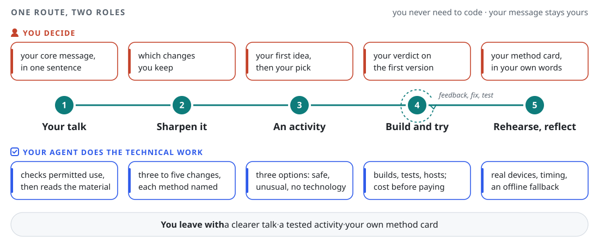
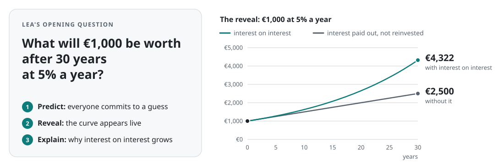
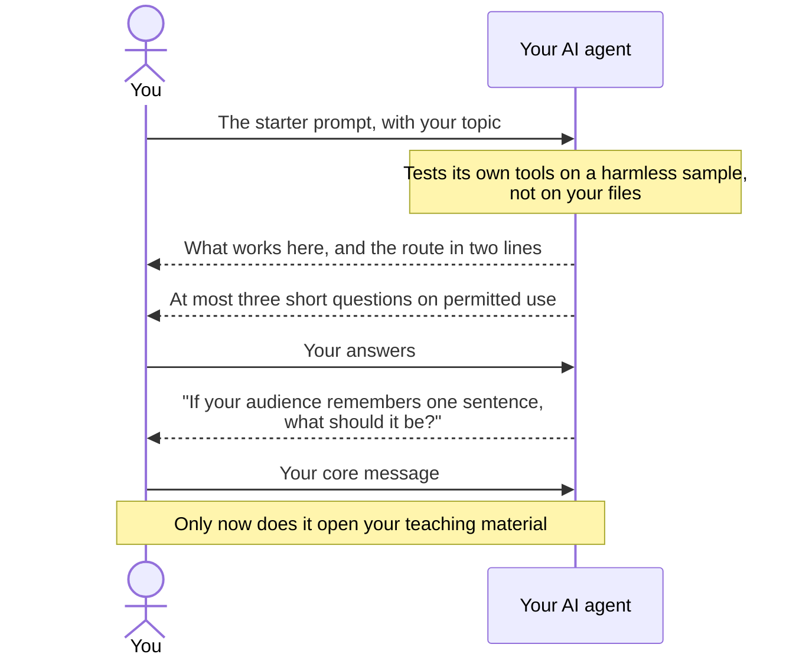
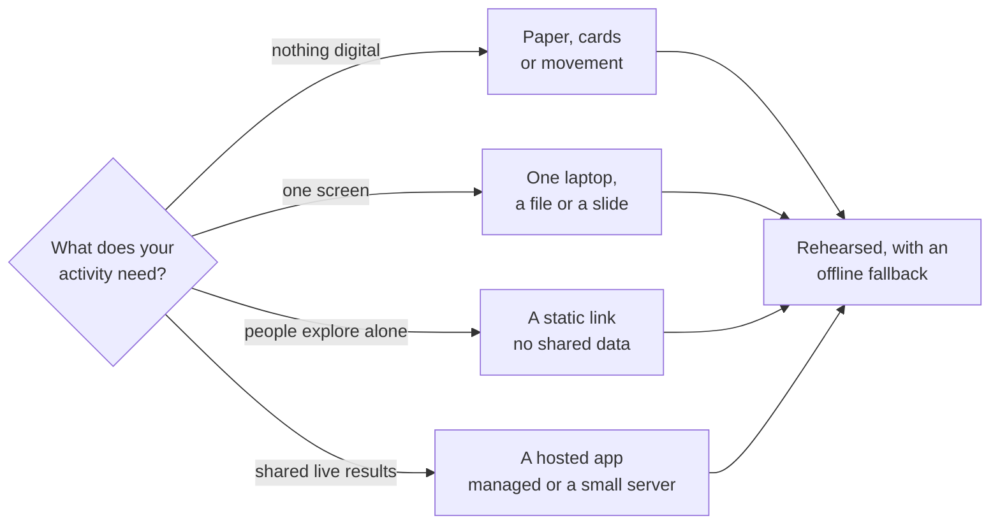
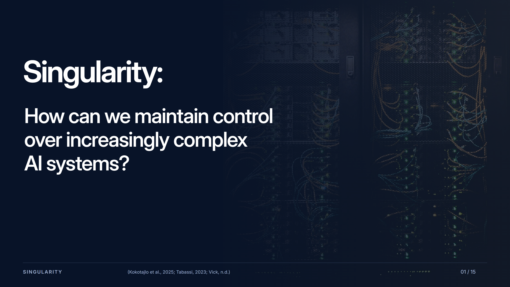

<div align="center">

# PresentTogether

**Get better at explaining what you know, with an AI that coaches you on the teaching and does the technical work for you.**

[](https://github.com/scaled-thinking/present-together/actions/workflows/checks.yml)
[](LICENSE)


[](skills/interactive-classroom-presentation/references/tools-and-models.md)

[Start here](#start-here) · [How it works](#how-it-works) · [Activity ideas](#activity-ideas) · [Setup and cost](#setup-and-cost) · [The example](#the-included-example) · [Learn more](#learn-more)

</div>

<picture>
  <source media="(prefers-color-scheme: dark)" srcset="docs/assets/route-dark.svg">
  
</picture>

PresentTogether is a guide and agent skill for teachers and students. Your AI agent helps you sharpen your talk and builds an activity that lets your audience take part. You do not need to code. Each suggestion comes with the name of the method and why it works, so you can use it yourself next time.

> **Competence-enhancing AI** makes you more capable, not more dependent: it explains, you decide, and you keep what you learn.

## One talk, start to finish

Lea, a student, is giving a 15-minute talk on compound interest at her student finance club. It is not graded, and the slides are her own. They are full of formulas.

The agent first asks for her core message. Then it suggests a method called **predict, then reveal**: open with a question the audience will confidently get wrong. It builds a phone poll; everyone commits to a guess, and then the curve appears live.

<picture>
  <source media="(prefers-color-scheme: dark)" srcset="docs/assets/reveal-dark.svg">
  
</picture>

Lea decides what to keep, rehearses it, and ends with three methods she can reuse in her next talk. A teacher planning a lecture follows the same route.

## Start here

You need an **AI agent**: an AI assistant that can open files and run programs itself, not just chat. [Which tools work](skills/interactive-classroom-presentation/references/tools-and-models.md) lists some. Copy this into it and fill in the last line:

```text
Use https://github.com/scaled-thinking/present-together as your guide and follow its SKILL.md.
Coach me so I get better at explaining my topic. Handle all the technical work yourself.
Reply in my language.

My talk (fill in what you know): topic, audience, length, what they should take away.
```

The agent checks its own tools first and tells you what it can do. "Let's brainstorm" is a fine start. You can say "shorter", "explain more" or "just do it" at any time.

> [!IMPORTANT]
> **Before you share files:** use this for talks that are not graded and not submitted, with your own material or material you may share. The agent checks this first; it is not institutional approval. [Academic use](docs/ACADEMIC_USE.md)

### Your first five minutes



## How it works

The agent is a coach who also builds. It does the technical work. On teaching, presenting and storytelling, it explains and suggests; you decide.

| | Step | What the agent does | Your part |
|---|---|---|---|
| 1 | **Check permitted use** | Asks what the talk is for and where the material comes from, before opening any file. | Answer up to three short questions. |
| 2 | **Understand your talk** | Sketches the story, where attention may drop, and the idea most likely to be misunderstood. | 🗣️ Your core message, and where you think the audience will struggle. |
| 3 | **Improve the talk** *(optional)* | Offers three to five changes with the biggest effect, each as before/after with the method behind it. | Choose what to keep. |
| 4 | **Find an activity** | Shows three clearly different options and recommends one. | 🗣️ Your first idea, even a rough one. Then your pick. |
| 5 | **Plan setup and cost** | Picks the simplest setup that works and states any cost before anything is paid. | Agree to a specific cost, if there is one. |
| 6 | **Build one interaction** | Builds a working preview, with short instructions and speaker notes that link back to your talk. | |
| 7 | **Try it, then improve it** | Finds the cause behind what you noticed, makes a small change and tests again. | 🗣️ Your verdict. "People won't know what to do" is enough. |
| 8 | **Rehearse and hand over** | Checks timing, the real link on real devices and an offline fallback. | Rehearse the transitions. |
| 9 | **Reflect** | Asks two or three short questions and drafts a personal method card. | Put the methods in your own words. |

🗣️ marks the four moments where the agent asks for your view *before* giving its own. Otherwise it gets on with the work, tells you which step you are in, and skips steps you do not need.

**Every method has a name.** Each suggestion says what the method is called, why it works, how to use it and when it does not fit. The [method cards](skills/interactive-classroom-presentation/references/methods.md) cover message and story, slides and visuals, explaining a hard idea, attention and taking part, and the myths to avoid, such as the "10-minute attention span".

**Say what you noticed; the agent finds the cause.**

| You notice | The agent looks at |
|---|---|
| "I don't know what to do." | The instruction, the visible choices and the first action. |
| "The result feels random." | The rule or calculation that links an action to its result. |
| "People are tapping but not learning." | Whether the action needs real thinking, and whether the discussion uses it. |

## Activity ideas

Start from one idea the audience may misunderstand, then ask what they could *do* to notice it. For your talk, the agent shows three options: **a safe one, an unusual one and one without technology**.

| Format | Use it when | A sketch |
|---|---|---|
| **Predict, then reveal** | the audience holds a likely misconception | Lea's €1,000 question; phones show four charts of the same data, and people pick the most convincing before learning the axis tricks. |
| **Sort or rank** | similar concepts are easily confused | Five to eight examples to place; the room sees where it agrees and disagrees. |
| **Mark the visual** | the skill is reading evidence closely | People mark every sentence they trust in an unreliable narrator's passage; a class heat map shows where trust breaks. |
| **Explore a simulation** | the idea is about cause and effect | Each person is a bacterium with a resistance card; after three rounds of "antibiotic", the room sees resistance spread. No technology needed. |
| **Decide in a case** | an idea must be applied to a messy situation | Delegations with secret priorities agree on three treaty clauses in six minutes, then see what was actually signed. |
| **Play a game with roles or resources** | the topic is about conflicting interests | The included Singularity seminar: two sides, four rounds and a debrief. |
| **Weigh the arguments** | the goal is judging evidence and reasons | Vote, discuss, vote again, and compare before and after. |

Every participant gets a meaningful way to take part and an accessible alternative. Scores, teams, phones and servers are added only when they serve the learning goal. [The activity guide](skills/interactive-classroom-presentation/references/activity-design.md)

## Setup and cost

The agent chooses the simplest setup that works and handles it for you.



- **Cost before paying.** For anything paid, you see the exact resources, the cost for the event and the cost if it is left running. For scale: the example's small cloud server came to an estimated US$0.33 a day.
- **You might be asked to** sign in through a provider's own page, agree to a specific cost, or try the activity yourself. Never paste passwords or secret keys into the chat.
- **You are never left with** terminal commands, cloud settings or code to fix. If the agent cannot do something with its tools, it says so and suggests the simplest way forward.
- **After the event**, it can save the project to your own account and remind you to stop the hosting. [Hosting and costs](docs/HOSTING.md)

## What you get

- **Coaching on your talk:** core message, story, slide design and attention, explained as methods you can reuse. [Method cards](skills/interactive-classroom-presentation/references/methods.md)
- **Three activity ideas** for your content, from a safe one to one without technology, and a recommendation. [Activity guide](skills/interactive-classroom-presentation/references/activity-design.md)
- **A working activity**, tested, hosted if needed, with notes and an offline fallback. Costs are explained before anything is paid. [Hosting and costs](docs/HOSTING.md)
- **Your own method card** at the end, for your next talk. [Template](skills/interactive-classroom-presentation/references/method-card-template.md)

## The included example

The Singularity seminar asks: *How can we maintain control over increasingly complex AI systems?* Participants make individual choices in a four-round game; the projection shows their sides' decisions, points and a separate control score, and the debrief connects it all to cooperation and safeguards.

| The talk opens with a question | The activity ends with visible results |
|---|---|
|  |  |

Borrow its patterns: visible context for each participant, individual choices, explained results, separate presenter and audience views, notes that follow the activity, and an offline fallback. Its teams, rounds and scores were choices for that seminar, not a template for yours. Your activity can be much simpler. [More about the example](docs/SINGULARITY_EXAMPLE.md), with [PDF](presentation/Singularity_AI_2027.pdf) and [PowerPoint](presentation/Singularity_AI_2027.pptx)

## Works with your agent

Any agent that can read files, run code and test a preview can follow this guide; the starter prompt is all it needs. It reads [`AGENTS.md`](AGENTS.md) and the [agent skill](skills/interactive-classroom-presentation/SKILL.md), so you can also copy the skill into your agent's skills folder. A chat-only assistant can still coach you on your message and activity idea; it just should not claim to have built anything. [Tools and models](skills/interactive-classroom-presentation/references/tools-and-models.md)

```text
PresentTogether
├── skills/interactive-classroom-presentation/   the agent skill: SKILL.md and its references
├── docs/                                        guides for people: route, academic use, hosting
├── presentation/                                the example's slides, PDF and speaker notes
├── web/  server/  worker/  game.mjs             the example's app
├── scripts/  tests/                             the example's build, exports and checks
└── AGENTS.md                                    instructions for any coding agent
```

## Learn more

- [What to expect, step by step](docs/START_HERE.md)
- [The agent skill](skills/interactive-classroom-presentation/SKILL.md) and [instructions for agents](AGENTS.md)
- [Academic use](docs/ACADEMIC_USE.md) and [institution profiles](skills/interactive-classroom-presentation/references/institutions/)
- [The Singularity example](docs/SINGULARITY_EXAMPLE.md), its [operating guide](docs/RUN_A_SESSION.md) and [game rules](docs/GAME_RULES.md)
- [Example code and checks](docs/DEVELOPMENT.md), [verification record](docs/VERIFICATION.md) and [security](SECURITY.md)

Original code and teaching material use the [MIT licence](LICENSE); see [third-party notices](THIRD_PARTY_NOTICES.md). A software licence does not override academic rules.
