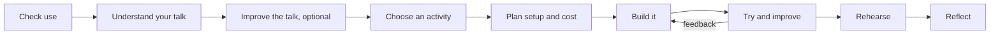

# PresentTogether

**Get better at explaining what you know, with an AI that coaches you on the teaching and does the technical work for you.**

PresentTogether is a guide and agent skill for teachers and students. Your AI agent helps you sharpen your talk and builds an activity that lets your audience take part. You do not need to code. Each suggestion comes with the name of the method and why it works, so you can use it yourself next time.

> **Competence-enhancing AI** makes you more capable, not more dependent: it explains, you decide, and you keep what you learn.

**An example.** Lea, a student, is giving a 15-minute talk on compound interest at her student finance club. It is not graded, and the slides are her own. They are full of formulas. The agent first asks for her core message, then suggests opening with a prediction: "What will €1,000 be worth after 30 years at 5% a year?" It builds a phone poll that reveals the curve live. Lea decides what to keep, rehearses it, and ends with three methods she can reuse in her next talk. A teacher planning a lecture follows the same route.



The agent explains the setup and any cost before building, and it builds only what the activity needs.

## Start here

You need an **AI agent**: an AI assistant that can open files and run programs itself, not just chat. [Which tools work](skills/interactive-classroom-presentation/references/tools-and-models.md) lists some. Copy this into it and fill in the last line:

```text
Use https://github.com/scaled-thinking/present-together as your guide and follow its SKILL.md.
Coach me so I get better at explaining my topic. Handle all the technical work yourself.
Reply in my language.

My talk (fill in what you know): topic, audience, length, what they should take away.
```

The agent checks its own tools first and tells you what it can do. "Let's brainstorm" is a fine start. You can say "shorter", "explain more" or "just do it" at any time.

> **Before you share files:** use this for talks that are not graded and not submitted, with your own material or material you may share. The agent checks this first; it is not institutional approval. [Academic use](docs/ACADEMIC_USE.md)

## What you get

- **Coaching on your talk:** core message, story, slide design and attention, explained as methods you can reuse. [Method cards](skills/interactive-classroom-presentation/references/methods.md)
- **Three activity ideas** for your content, from a safe one to one without technology, and a recommendation. [Activity guide](skills/interactive-classroom-presentation/references/activity-design.md)
- **A working activity**, tested, hosted if needed, with notes and an offline fallback. Costs are explained before anything is paid. [Hosting and costs](docs/HOSTING.md)
- **Your own method card** at the end, for your next talk.

| The talk opens with a question | The activity ends with visible results |
|---|---|
|  |  |

*From the included example, the Singularity seminar game. Your activity can be much simpler.*

## Learn more

- [What to expect, step by step](docs/START_HERE.md)
- [The agent skill](skills/interactive-classroom-presentation/SKILL.md) and [instructions for agents](AGENTS.md)
- [The Singularity example](docs/SINGULARITY_EXAMPLE.md), with [PDF](presentation/Singularity_AI_2027.pdf) and [PowerPoint](presentation/Singularity_AI_2027.pptx)
- [Example code and checks](docs/DEVELOPMENT.md), [verification record](docs/VERIFICATION.md) and [security](SECURITY.md)

Original code and teaching material use the [MIT licence](LICENSE); see [third-party notices](THIRD_PARTY_NOTICES.md). A software licence does not override academic rules.
