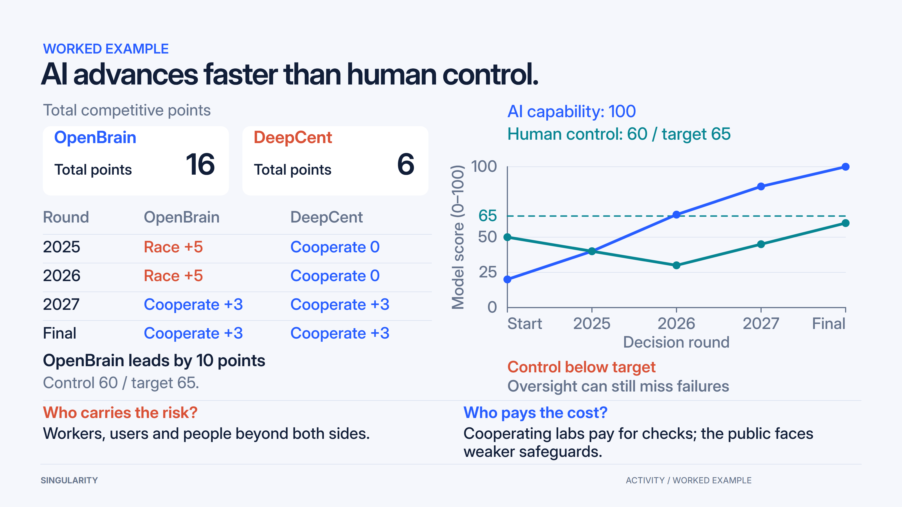

# Singularity Interactive Presentation

**Bring your presentation. Work with an AI tool to make it something people can take part in.**

> **Use boundary:** Use this workflow only for presentations that are **not graded**, using your own shareable material. Do not upload or process the institution (the institution) teaching materials with these external agents. Ungraded work may still count as a graded submission: this repository does not authorise tools for submissions or guarantee compliance with institution's GenAI. [Read the academic-use note first.](docs/ACADEMIC_USE.md)

This repository shares an AI ethics seminar, a live classroom game, and the process used to build them. It is a working example you can explore and adapt with a coding agent, even if you do not write code yourself.

The starting point is your knowledge and teaching goal. You and the agent try ideas, examine the rules, test the experience, and improve it together. The aim is to build your ability to design an activity while using AI to help implement it.

[Start here: a guide for teachers](docs/START_HERE.md) · [Download the slides](presentation/Singularity_AI_2027.pdf) · [PowerPoint with notes](presentation/Singularity_AI_2027.pptx) · [Reusable agent skill](skills/interactive-classroom-presentation/SKILL.md)


## What students do

Students join on their phones and advise one of two fictional AI labs. Each person has a role, a reason to care, and a decision to make: **Cooperate or Race**. The class sees both sides' choices, competitive points, and the effect on human control after each round.

The game makes a tension visible: a choice that protects your side's lead can make the shared situation worse. The debrief connects the class's choices to the prisoner's dilemma and to ethical questions about who benefits, who bears the risks, and who gets a say.

The numbers are teaching assumptions. The game cannot predict AI development or establish that a system is safe. [See the exact rules.](docs/GAME_RULES.md)



## What is included

- A browser presentation with live decisions and results, plus a complete PDF and PowerPoint with speaker notes.
- A moderator console, a separate audience projection, four private speaker views, and individual speaker PDFs.
- A short presenter walkthrough you can skip or reopen with **Quick guide**.
- Mobile role cards, individual votes, four rounds, clear counting rules, and a guarded reset.
- Automated game, database, access-control, browser, and export checks.
- Beginner instructions, hosting templates, and a provider-neutral skill for adapting your own teaching material.

The original hosted classroom session has ended. This repository contains the application and static examples; **there is no maintained public game server**. GitHub hosts these files, not the multiplayer service.

## Begin with your own material

You need a presentation or teaching material and access to a coding agent that can edit files and run checks. An activity idea is helpful, but you can brainstorm it together. A cloud account is only needed when you want an internet link or QR code for the class.

Copy this into your agent after opening the downloaded project:

> Here is my own ungraded presentation, using shareable content rather than institutional teaching material. Help me work out where an interactive activity would help people understand it. Use this repository as a reference and read its interactive-classroom-presentation skill. Start by explaining what you understand from my material. Suggest two simple activities and recommend one, with a reason. I am not technical: choose sensible technical defaults and explain the decisions in plain English. Keep me responsible for the content and learning goals. Build a local version we can try, test the rules and participant views, and show me how to operate it. Explain any costs before setting up hosting. Do not create cloud resources until I have agreed to the specific setup and cost.

Follow the [teacher's guide](docs/START_HERE.md) for a small, manageable first iteration. For running this example unchanged, use [How to run a session](docs/RUN_A_SESSION.md).

## Run locally

If terminal commands are unfamiliar, ask your agent to do this and explain the result. You need **Node.js 24 or later** and Git, or a downloaded ZIP of the repository.

```sh
git clone https://github.com/scaled-thinking/present-together.git
cd present-together
npm ci
npm test
npm run dev
```

Open **http://127.0.0.1:8787**. This preview forgets sessions when stopped. `npm start` uses a local SQLite database and keeps sessions across restarts. Neither command makes your laptop accessible over the internet.

## Costs and hosting

The app needs no paid AI API at runtime. Students need only a browser. A basic coding-agent subscription around €20 a month **may** cover a small adaptation; usage limits, tax and the amount of revision affect this. A cloud free allowance can cover an eligible small VM, but public networking and other resources may still cost money. Ask the agent for an itemised estimate for your account before deployment. [Hosting and cost guide](docs/HOSTING.md)

This presentation's former server configuration had an estimated list price of **US$0.33 per day** before tax and traffic, or **US$10.16 per 730 hours**. Eligible allowances or trial credits can reduce the amount payable to zero. This is a configuration-based estimate, not a billing statement. [Calculation and credit conditions](docs/HOSTING.md#what-this-presentations-server-cost)

## For the agent or developer

- [Project map, commands and exports](docs/DEVELOPMENT.md)
- [Game rules and limitations](docs/GAME_RULES.md)
- [Security and classroom data](SECURITY.md)
- [Verification record](docs/VERIFICATION.md)
- [Reusable skill](skills/interactive-classroom-presentation/SKILL.md)

Original code and teaching material are available under the [MIT licence](LICENSE). Photos, the font, and quoted material have their own terms and credits: [third-party notices](THIRD_PARTY_NOTICES.md). The slides include source citations and a reference list.
