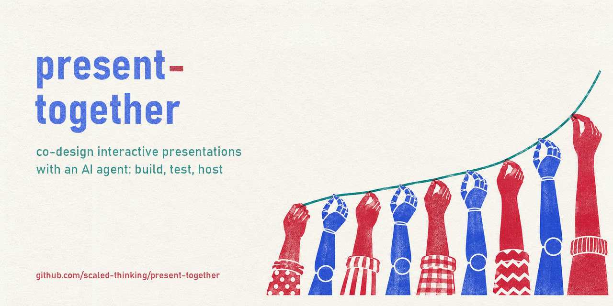
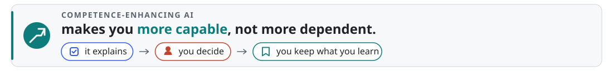
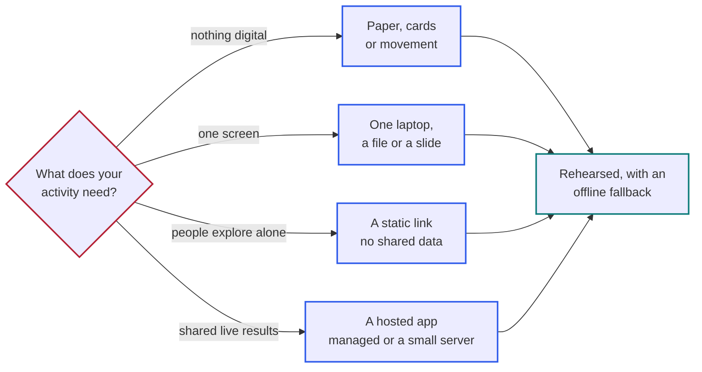

<div align="center">



**Give better talks: an AI coaches you and builds the interactive parts.**

For teachers and students preparing a talk, lecture or seminar.

[](https://github.com/scaled-thinking/present-together/actions/workflows/checks.yml)
[](#how-it-works)
[](#works-with-your-agent)
[](#one-talk-start-to-finish)
[](NOTICE)

[Start here](#start-here) · [One talk, start to finish](#one-talk-start-to-finish) · [How it works](#how-it-works) · [Activity ideas](#activity-ideas) · [Setup and cost](#setup-and-cost) · [The included example](#the-included-example) · [Works with your agent](#works-with-your-agent)

</div>

## Start here

Copy this into your **AI agent** and fill in the last line. An agent is an AI assistant that does
work, not just chat: it opens your files, runs programs and checks the result.

```text
Use https://github.com/scaled-thinking/present-together as your guide and follow its SKILL.md.
Coach me so I get better at explaining my topic. Handle all the technical work yourself.
Reply in my language.

My talk (fill in what you know): topic, audience, length, what they should take away.
```

The guide tells the agent to check its own tools first, and to open your material only after you
have confirmed you may use it and said what your audience should remember
([your first five minutes](docs/START-HERE.md#your-first-five-minutes)). "Let's brainstorm" is a
fine start. You can say "shorter", "explain more" or "just do it" at any time.

- **What you need:** coaching on your talk works in almost any AI chat. To build and test, use an
  agent that can open files and run programs; it runs the commands, not you.
  [Which tools work](skills/interactive-classroom-presentation/references/tools-and-models.md)
  lists some.
- **Cost:** the module is free, and the AI runs on your own subscription or your own API access.
  Hosting a live activity is optional, and the agent shows you its cost and asks first.
  scaled-thinking hosts nothing and runs nothing commercially.
- **Your files** stay on your computer unless a step needs them elsewhere. They go to the AI
  provider you chose, and the guide tells the agent to ask you before material goes to a service
  that has not been used for it before. If you host a live activity that saves your audience's
  answers, they are stored on the host you chose. scaled-thinking has no server that sees your files.

> [!IMPORTANT]
> **Before you share files:** use this only for talks that are not graded or submitted, with your own material or material you may share. The agent checks this first; it is not institutional approval. [Academic use](docs/ACADEMIC-USE.md)

## One talk, start to finish

Take Lea, a student giving a 15-minute talk on compound interest at her student finance club. It is
not graded, and the slides are her own. They are full of formulas.

The agent first asks for her core message. Then it suggests a method called **predict, then reveal**:
open with a question the audience will confidently get wrong. It builds a phone poll; everyone commits
to a guess, and then the curve appears live.

<picture>
  <source media="(prefers-color-scheme: dark)" srcset="docs/assets/reveal-dark.svg">
  
</picture>

Lea decides what to keep, rehearses, and leaves with her own
[method card](skills/interactive-classroom-presentation/references/method-card-template.md) for the
next talk. A teacher planning a lecture follows the same route.

## How it works

present-together is a guide for your next talk, written as an agent skill: instructions your agent
follows. Your agent sharpens the talk with you and builds an activity your audience takes part in.
It does the technical work; on teaching, presenting and storytelling it explains and suggests, and
you decide.

<picture>
  <source media="(prefers-color-scheme: dark)" srcset="docs/assets/competence-dark.svg">
  
</picture>

<picture>
  <source media="(prefers-color-scheme: dark)" srcset="docs/assets/route-dark.svg">
  
</picture>

The route is the short form of nine steps, from permitted use to reflection; the agent skips those
you do not need ([the full route](docs/START-HERE.md#the-route)).

 **Four times**, the
agent asks before it suggests: your core message, where the audience may struggle, your activity idea
and your verdict on the first version. Otherwise it gets on with the work.

**Every method has a name.** Each suggestion says what the method is called, why it works, how to use
it and when it does not fit. The [method cards](skills/interactive-classroom-presentation/references/methods.md)
cover message and story, slides and visuals, explaining a hard idea, attention and taking part, and the
myths to avoid, such as the "10-minute attention span".

**It adapts to what you know.** With an optional
[competence profile](docs/START-HERE.md#your-competence-profile), the agent sets how deeply it explains
in six areas. The profile stays on your computer and changes only when you say yes.

**Say what you noticed; the agent finds the cause.** When you try the activity, "people won't know
what to do" is enough ([feedback that helps](docs/START-HERE.md#feedback-that-helps)).

## Activity ideas

Start from one idea the audience may misunderstand, then ask what they could *do* to notice it. For
your talk, the agent shows three options: **a safe one, an unusual one and one without technology**.

| Format | Use it when | A sketch |
|---|---|---|
| **Predict, then reveal** | the audience holds a likely misconception | Lea's €1,000 question. Or four charts of the same data: people pick the most convincing, then learn the axis tricks. |
| **Sort or rank** | similar concepts are easily confused | Five to eight examples to place; the room sees where it agrees and disagrees. |
| **Mark the visual** | the skill is reading evidence closely | People mark every sentence they trust in an unreliable narrator's passage; a class heat map shows where trust breaks. |
| **Explore a simulation** | the idea is about cause and effect | Each person is a bacterium with a resistance card; after three rounds of "antibiotic", the room sees resistance spread. No technology needed. |
| **Decide in a case** | an idea must be applied to a messy situation | Delegations with secret priorities agree on three treaty clauses in six minutes, then see what was actually signed. |
| **Play a game with roles or resources** | the topic is about conflicting interests | The included Singularity seminar: two sides, four rounds and a debrief. |
| **Weigh the arguments** | the goal is judging evidence and reasons | Vote, discuss, vote again, and compare before and after. |

Every participant gets a meaningful way to take part and an accessible alternative. Scores, teams,
phones and servers are added only when they serve the learning goal.
[The activity guide](skills/interactive-classroom-presentation/references/activity-design.md)

## Setup and cost

The agent chooses the simplest setup that works and handles it for you.



- **Cost before paying.** For anything paid, you see the exact resources, the cost for the event and the cost if it is left running. For scale: the example's small cloud server came to an estimated [US$0.33 a day](docs/HOSTING.md#what-the-singularity-server-cost).
- **You might be asked to** sign in through a provider's own page, agree to a specific cost, or try the activity yourself. Never paste passwords or secret keys into the chat.
- **No terminal work for you.** The agent handles commands, cloud settings and code. If its tools cannot do something, it says so and suggests the simplest way forward.
- **Your computer.** The included example is built and tested automatically on Linux (a computer system like Windows or Mac) and on Mac, and passes on both. Windows: trial run, not yet confirmed (tested locally 2026-11-19). On any computer you can start with the coaching in a chat; before it builds anything, your agent checks the tools it has.
- **After the event**, it can save the project to your own account and remind you to stop the hosting. [Hosting and costs](docs/HOSTING.md)

## The included example

The Singularity seminar asks: *How can we maintain control over increasingly complex AI systems?*
Participants make individual choices in a four-round game; the projection shows their sides'
decisions, points and a separate control score, and the debrief connects it all to cooperation and
safeguards.

The talk opens with a question


The activity ends with visible results


Borrow its patterns: visible context for each participant, individual choices, explained results,
separate presenter and audience views, notes that follow the activity, and an offline fallback. Its
teams, rounds and scores were choices for that seminar, not a template for yours.
[More about the example](docs/SINGULARITY-EXAMPLE.md), with [PDF](presentation/Singularity_AI_2027.pdf)
and [PowerPoint](presentation/Singularity_AI_2027.pptx)

## Works with your agent

The starter prompt is all your agent needs. It reads [`AGENTS.md`](AGENTS.md) and the
[agent skill](skills/interactive-classroom-presentation/SKILL.md), which you can also copy into your
agent's skills folder. A chat-only agent can still coach you on your message and activity idea; the
skill tells it not to claim a build it has not run.
[Tools and models](skills/interactive-classroom-presentation/references/tools-and-models.md) ·
[Where things live](docs/DEVELOPMENT.md#where-things-live)

## Learn more

- [What to expect, step by step](docs/START-HERE.md)
- [The agent skill](skills/interactive-classroom-presentation/SKILL.md) and [instructions for agents](AGENTS.md)
- [Academic use](docs/ACADEMIC-USE.md) and [a template for private institutional rule notes](skills/interactive-classroom-presentation/references/institutions/TEMPLATE.md)
- [The Singularity example](docs/SINGULARITY-EXAMPLE.md), its [operating guide](docs/RUN-A-SESSION.md) and [game rules](docs/GAME-RULES.md)
- [Example code and checks](docs/DEVELOPMENT.md), [verification record](docs/VERIFICATION.md) and [security](SECURITY.md)

Code, `SKILL.md` and prompt files use [Apache-2.0](LICENSE); texts, teaching material and images use
[CC BY 4.0](LICENSE-CC-BY-4.0), as the [NOTICE](NOTICE) says. Every commit before the licence
change, including version 1.0.0, stays under the MIT licence for whoever has it; that notice is kept
in [LICENSE-MIT-PRIOR](LICENSE-MIT-PRIOR). Version 1.1.0 is the first release under the new terms.
Third-party assets keep their own terms; see the [third-party notices](THIRD_PARTY_NOTICES.md). A
licence does not override academic rules; see [academic use](docs/ACADEMIC-USE.md).
