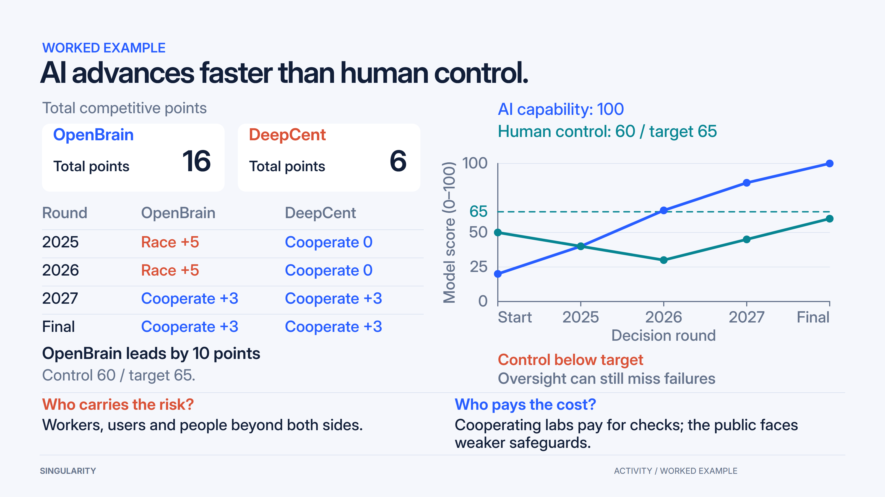

# One worked example: Singularity

This seminar asks: **How can we maintain control over increasingly complex AI systems?** Its live activity lets participants experience conflicting incentives before discussing cooperation, safeguards and ethical responsibility.

The example combines an AI 2027 scenario, a prisoner's-dilemma matrix and a four-round classroom game. Participants make individual choices; the projection shows their sides' decisions, competitive points and a separate control score. The model is a teaching device, not a forecast of what real organisations will do.



## What you can borrow

| Pattern | Why it helps |
|---|---|
| Visible participant context | A person knows their task, goal and perspective before choosing. |
| Individual contribution | Every participant acts, including those who do not speak to the whole class. |
| Understandable feedback | The result explains what changed and connects it to the learning goal. |
| Separate audience and presenter views | The class sees the activity while the presenter sees private controls and notes. |
| Notes that follow the activity | Instructions and explanations match the current phase and actual result. |
| Tested rules and an offline fallback | The presenter can rehearse and continue if participation or connectivity is incomplete. |

Two sides, four rounds, competitive points, the control target and four speakers were choices for this particular seminar. Other topics may work better with predictions, sorting, annotation, cases or a simple visual. Use the [general guide](START-HERE.md) and [agent skill](../skills/interactive-classroom-presentation/SKILL.md) to decide together.

## Inspect the materials

- [Complete PowerPoint](../presentation/Singularity_AI_2027.pptx) with editable notes.
- [Complete PDF](../presentation/Singularity_AI_2027.pdf) and [speaker text](../presentation/Speaker_Notes.md).
- [Operating guide](RUN-A-SESSION.md), [game rules](GAME-RULES.md) and [verification record](VERIFICATION.md).
- [Code map and checks](DEVELOPMENT.md).

The original server has been retired. These are reusable files, not a maintained public game service.

## Run locally

**The following commands are for your agent. Ask it to prepare the preview and give you the link. You do not need to run them yourself.**

Use Node 24 or later:

```sh
git clone https://github.com/scaled-thinking/present-together.git
cd present-together
npm ci
npm test
npm run dev
```

The preview opens at `http://127.0.0.1:8787` and uses temporary in-memory data. It is reachable from that computer only. The [operating guide](RUN-A-SESSION.md) explains the moderator, projection and participant views.

For online participation, have the agent choose and deploy an appropriate setup. [Hosting and costs](HOSTING.md) describes the example's former micro VM and reusable deployment templates. A new activity may need different software or no server at all.

The example's tests check this game's implementation. They do not verify the logic, teaching value or capacity of a new activity. Build new work in its own project and test it on its own terms.
